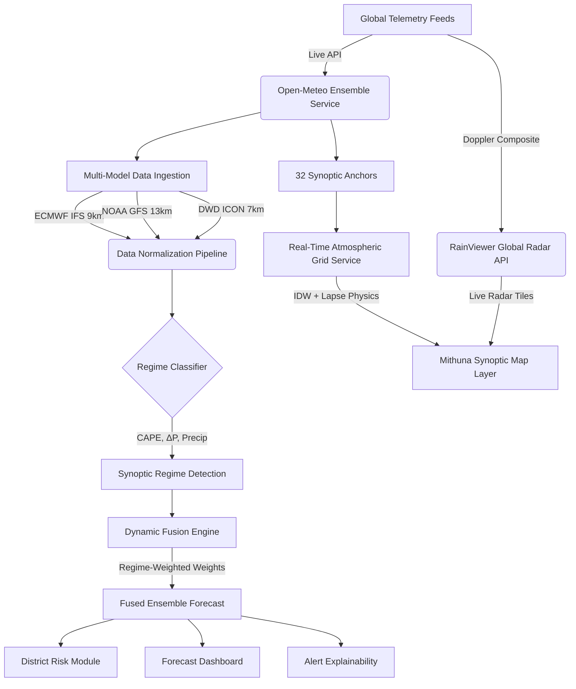

# WeatherCast — Intelligent Multi-Model Weather & Risk Platform
> **Smart India Hackathon 2026 Submission**  
> An adaptive multi-model meteorological fusion engine, district-level risk intelligence system, and real-time synoptic atmospheric map viewer.

---

## 📌 Executive Summary

Modern Numerical Weather Prediction (NWP) models frequently diverge during extreme Indian weather regimes. Single-model forecasts suffer from systematic biases:
- **NOAA GFS** tends to overpredict tropical convective precipitation amounts.
- **ECMWF IFS** excels in 4D-Var data assimilation and cyclone track prediction, but can lag on sudden localized squall lines.
- **DWD ICON** provides superior non-hydrostatic boundary layer microphysics.

**WeatherCast** eliminates single-model vulnerability by implementing an **Adaptive Multi-Model Dynamic Fusion Engine**. Rather than relying on a static ensemble average, WeatherCast classifies the active synoptic regime (Monsoon Depression, Tropical Cyclone, Heatwave, Convective Storm) in real time and dynamically reweights ECMWF, GFS, and ICON streams according to peer-reviewed NWP verification scores.

---

## 🌟 Key Capabilities

### 1. 🌐 Mithuna Synoptic Atmospheric Map (Real-Time NWP & Radar)
A high-resolution meteorological visualization inspired by NCMRWF Mithuna GLB:
- **Live Multi-Station Operational Grid**: Ingests real-time operational telemetry across 32 regional synoptic anchor stations covering India, the Arabian Sea, Bay of Bengal, and the Middle East via Open-Meteo.
- **Spatial IDW Interpolation with Thermodynamic Lapse Rates**: Reconstructs continuous thermodynamic scalar fields (Temperature, Relative Humidity, Precipitation Rate, Accumulated Rain) with altitude lapse-rate correction across pressure levels (1000 hPa Surface to 200 hPa Upper Troposphere).
- **Dynamic 60 FPS Wind Vector Streamlines**: Real-time particle advection engine flowing along observed eastward ($u$) and northward ($v$) wind velocity vectors.
- **Live Doppler Radar Integration**: Ingests real-time global composite Doppler radar tiles from RainViewer API (updated every 10 minutes) for actual live storm tracking.
- **Meteorological Controls**:
  - Administrative boundary filters (`[x] India`, `[x] States`, `[x] Global`).
  - Synoptic model selection (`Mithuna GLB`, `ECMWF IFS`, `NOAA GFS`, `NCUM Regional`).
  - Weather parameter selectors with discrete colorbar scales ($-15^\circ\text{C}$ to $45^\circ\text{C}+$).
  - Pressure level slider ($1000\text{ hPa} \to 200\text{ hPa}$) and real-time layer opacity control.
  - Interactive hover point probe showing exact coordinates, parameter values, and wind speed.

### 2. 🧠 Adaptive Dynamic Fusion Engine
- **Synoptic Regime Classifier**: Continuously evaluates atmospheric instability metrics (Precipitation rate, CAPE, pressure tendency $\Delta P$, wind shear, thermal anomalies).
- **Regime-Conditioned Weighting**:
  - *Tropical Cyclone*: High weight to ECMWF (65-70%) due to superior 4D-Var track error metrics.
  - *Monsoon Depression*: Balanced ECMWF (55%) + GFS (30%) + ICON (15%) to prevent convective false alarms.
  - *Heatwave*: Boosted GFS weight to capture rapid diurnal boundary layer heating peaks.
- **Metric-Level Fusion**: Independently weights temperature, precipitation, pressure, and wind vectors.

### 3. 📊 Multi-Model Comparison & Benchmarking
- Side-by-side real-time parameter comparison across ECMWF, GFS, and ICON.
- Lead-time degradation curves (+6h, +12h, +24h, +48h, +72h).
- Ensemble spread and inter-model consensus index.

### 4. 🗺️ District-Level Disaster Risk Map (India)
- Calibrated to National Disaster Management Authority (**NDMA**) and **IMD** warning thresholds.
- Real-time hazard classification across key districts (Chennai, Mumbai, Wayanad, Ahmedabad, Bhubaneswar, Shimla, etc.).
- Color-coded risk tiers: **Very High Risk** (Red), **High Risk** (Orange), **Moderate Risk** (Blue), and **Low Risk** (Green).

### 5. 🔍 Alert Explainability & Decision Support
- "Glass-box" explainability: Displays why an alert was triggered, model divergence metrics, primary driver variables, and historical analog confidence for disaster relief authorities.

---

## 🏗️ System Architecture



---

## 🛠️ Tech Stack

- **Frontend Core**: React 19, TypeScript
- **Build Tool**: Vite 8 with Hot Module Replacement (HMR)
- **Mapping & Geospatial**: Leaflet 1.9, HTML5 Canvas 2D Rendering Engine
- **Icons & UI**: Lucide React
- **Meteorological Data Sources**:
  - [Open-Meteo API](https://open-meteo.com/) (Operational ECMWF IFS, NOAA GFS, DWD ICON)
  - [RainViewer Global Doppler Radar API](https://www.rainviewer.com/api.html)
  - Natural Earth / Survey of India Boundary Datasets

---

## 🚀 Quick Start Guide

### Prerequisites
- Node.js (v18.0.0 or higher recommended)
- npm or yarn

### Installation & Local Setup

1. **Clone the repository:**
   ```bash
   git clone https://github.com/your-username/WeatherCast.git
   cd WeatherCast
   ```

2. **Install dependencies:**
   ```bash
   npm install
   ```

3. **Start the local development server:**
   ```bash
   npm run dev
   ```
   Open your browser and navigate to `http://localhost:5173/`.

4. **Build for production:**
   ```bash
   npm run build
   ```

---

## 📂 Project Structure

```
WeatherCast/
├── public/                 # Static assets
├── src/
│   ├── components/         # React presentation components
│   │   ├── Header.tsx              # Top navigation, search, regime badge & tabs
│   │   ├── MithunaAtmosphericMap.tsx # Real-time synoptic map, wind vectors & radar
│   │   ├── ForecastDashboard.tsx   # Hourly & 7-day fused forecast dashboard
│   │   ├── ModelComparison.tsx     # Multi-model benchmarking & weight breakdown
│   │   ├── DistrictRiskMap.tsx     # District risk tiers & Leaflet hazard zones
│   │   └── AlertExplainability.tsx # Glass-box alert explanation engine
│   ├── data/
│   │   ├── geoBoundaries.ts        # Smooth high-res India & global border paths
│   │   └── indiaDistricts.ts       # District stations & NDMA risk criteria
│   ├── services/
│   │   ├── openMeteoService.ts     # Operational NWP multi-model API client
│   │   ├── realtimeAtmosphericService.ts # 32-station real-time grid & RainViewer API
│   │   ├── mithunaSimulationService.ts   # Thermodynamic palette & lapse physics
│   │   ├── regimeClassifier.ts     # Weather regime detection heuristics
│   │   └── fusionEngine.ts         # Dynamic multi-model fusion algorithm
│   ├── types/
│   │   └── weather.ts              # TypeScript meteorological type definitions
│   ├── App.tsx                     # Main application layout & view switcher
│   ├── main.tsx                    # React entrypoint
│   └── index.css                   # Premium dark glassmorphic design system
├── package.json
└── README.md
```

---

## 🇮🇳 Smart India Hackathon Alignment

- **Problem Addressed**: Inaccurate single-model forecasts leading to disaster response delays or false alarm fatigue during Indian monsoons and heatwaves.
- **Solution Delivered**: An open, explainable, multi-model platform providing localized district-level hazard advisories alongside an operational synoptic map matching IMD/NCMRWF operational standards.

---

## 📄 License
This project is licensed under the MIT License — see the LICENSE file for details.
